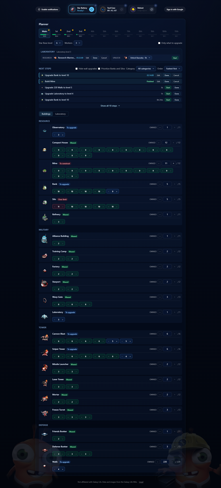
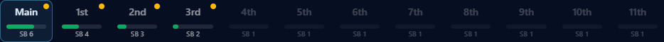
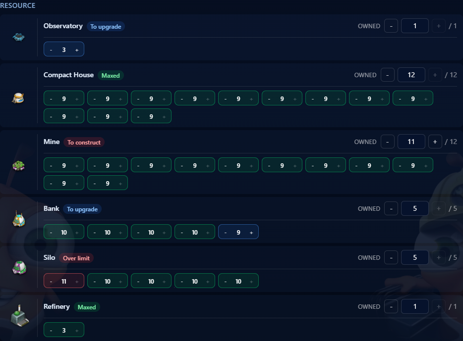
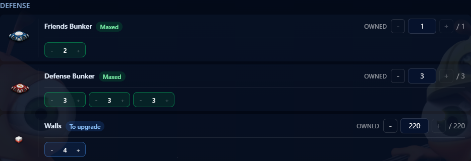
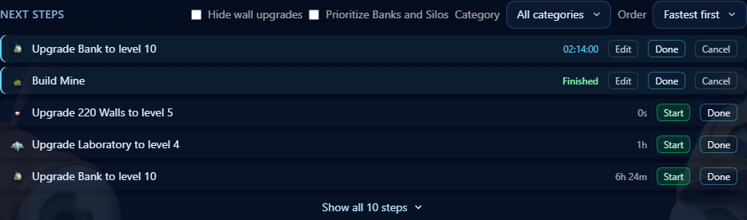
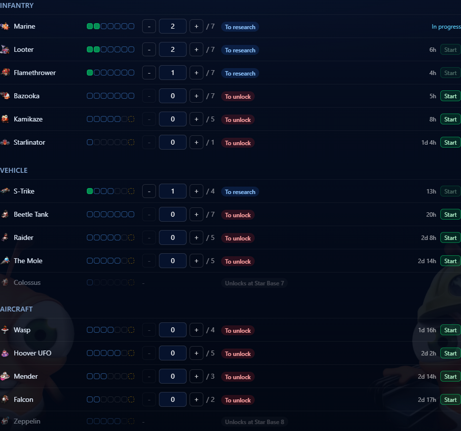
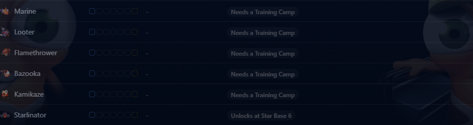
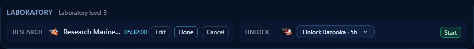
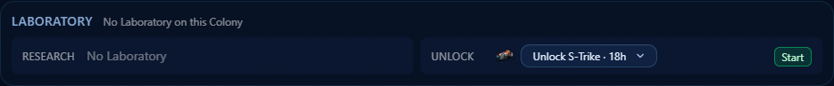
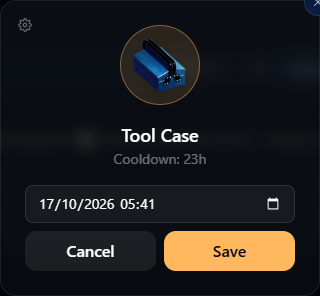

# GL Upgrade Planner

A companion for Galaxy Life players. Track what you have built on each of your Colonies, see what your Star Base still lets you build or upgrade, follow your Constructions, Research and Unlock, and never forget to collect your free Drops.

Use it here: <https://amaroke.github.io/GL-Upgrade-Planner/>

No account is needed. Everything you enter is saved in your browser, so it is still there the next time you open the site on the same device.

## Contents

1. [Colonies](#colonies)
2. [Star Base and Workers](#star-base-and-workers)
3. [Buildings](#buildings)
4. [Next steps](#next-steps)
5. [Constructions](#constructions)
6. [Laboratory](#laboratory)
7. [Drops](#drops)
8. [Tab title and notifications](#tab-title-and-notifications)
9. [Sign in and sync](#sign-in-and-sync)

## Colonies

The Planner starts with one tab per Colony: your Main planet, then the 11 other Colonies, named 1st to 11th. Each other Colony is unlocked by one level of the Observatory on your Main planet: Observatory level 1 unlocks the 1st Colony, level 2 the 2nd, and so on. Locked Colonies are greyed out until you enter the Observatory level that unlocks them.

Each tab shows:

- a progress bar, which fills up as the Colony's Buildings get closer to the maximum of the game
- the Colony's Star Base level (for example SB 6)
- a yellow dot when the Colony has a free Worker with something left to build or upgrade, or an idle Laboratory slot

Click a tab to open that Colony.

## Star Base and Workers

Pick the **Star Base level** of the Colony first. Every limit of the Colony updates at once: how many of each Building you can own, their maximum level, the Unit types you can use and the Next steps.

Set how many **Workers** the Colony has, from 1 to 5. Each running Construction occupies one Worker. When they are all busy, the Colony shows **No free Worker** and you cannot start another Construction there until one is Finished.

## Buildings

Below the Colony settings, the **Buildings** view lists every Building type the Colony can have, grouped by category: Resource, Military, Tower and Defense. Some Building types, like the Observatory, only exist on the Main planet.

For each Building type:

- **Owned** shows how many you have out of the maximum the Star Base allows (for example 11 / 12). Use the **-** and **+** buttons, or type the number.
- Each Building you own gets its own box with its level. Use **-** and **+**, or type the level, up to the maximum the Star Base allows.
- A Building type that the current Star Base level does not allow yet is greyed out and shows the Star Base level that unlocks it.

**Walls** work differently: all your Walls share one level, so you set the number of Walls and a single level for all of them.

### Statuses

Each Building type shows a status, and each level box is coloured the same way:

| Status      | Badge        | Meaning                                                  |
| ----------- | ------------ | -------------------------------------------------------- |
| Missing     | To construct | You own fewer than the Star Base allows                  |
| Below limit | To upgrade   | At least one Building is below the maximum level         |
| Over limit  | Over limit   | A count or level is above what the Star Base now allows  |
| Maxed       | Maxed        | Nothing left to build or upgrade at this Star Base level |

Lowering the Star Base level never deletes anything: Buildings above the new limits are simply flagged Over limit, and they come back to normal when you raise the Star Base again.

Tick **Only what to upgrade** to hide the Maxed Building types and keep only what still needs work.

## Next steps

**Next steps** lists what you can do on the Colony, each with the time it takes in the game:

- raise the Star Base by one level
- build one Missing Building
- raise one Building Below limit by one level

Unit types are handled in the [Laboratory](#laboratory).

Use the controls above the list to shape it:

- **Order**: **Fastest first** or **Longest first**
- **Category**: only one category of Building, or **All categories**
- **Hide wall upgrades**: leave Walls out of the list
- **Prioritize Banks and Silos**: move Bank and Silo steps to the top

The list shows the first 5 rows. Click **Show all N steps** to see them all, and **Show fewer steps** to fold it again.

## Constructions

When you start something in the game, start it in the Planner too, so you know when it ends.

- Click **Start** on a Next step. It becomes a Construction, shown at the top of Next steps with a countdown to its Finish date. It occupies one Worker.
- When the duration of a step is unknown ("time unknown"), **Start** asks you to type it, for example `1h 30m` or `2d 4h`.
- **Edit** lets you type the remaining time, if the game shows something different (after a speed-up, for example).
- **Cancel** asks for a confirmation, then removes the Construction without changing your Buildings.
- When the Finish date has passed, the countdown turns into **Finished** and the Worker is free again.
- Click **Done** to apply the change: the Building gets its new level or is added to the Colony, and the Construction disappears.

You can also click **Done** directly on a Next step that you already did in the game, without starting it first.

## Laboratory

Each Colony has its own Laboratory and its own Unit levels: what you research on one Colony does not change the others.

### Unit types

Switch from **Buildings** to **Laboratory** under Next steps to see every Unit type of the Colony, grouped into Infantry, Vehicle and Aircraft. For each Unit type you see its level, which you can change with **-** and **+**, and its status:

- **To unlock**: the Unit type is available but not unlocked yet
- **To research**: the Unit level is below the maximum
- **Maxed**: the Unit level has reached the maximum
- **Over limit**: the Unit level is above the maximum, after you lowered the Laboratory level

The Unit level is capped by the level of the Colony's Laboratory: a higher Laboratory allows higher Unit levels.

A Unit type you cannot use yet is greyed out with the reason:

- **Unlocks at Star Base N**: the Star Base is too low
- **Needs a Training Camp**, **Needs a Factory** or **Needs a Starport**: the Colony does not own the Building that trains this Unit type

The Marine is at level 1 as soon as the Colony has a Training Camp. Every other Unit type needs an Unlock first.

### Research and Unlock

The Laboratory strip, above Next steps, has two slots:

- **Research** raises one Unit level by one
- **Unlock** takes one Unit type to level 1

Pick what to run from the list of each slot and click **Start**, or click **Start** next to a Unit type in the Laboratory view. Each Colony runs at most one Research and one Unlock at a time, side by side. Neither of them uses a Worker.

A Research cannot start while the Laboratory itself is being upgraded, and the Research slot shows **No Laboratory** when the Colony has no Laboratory.

A running Research or Unlock works like a Construction: a countdown to its Finish date, then **Finished**. Use **Edit** to correct the remaining time, **Cancel** to stop it after a confirmation, and **Done** to apply it to the Unit level.

## Drops

The top of the page tracks the three free Drops and their Cooldown:

| Drop         | Cooldown |
| ------------ | -------- |
| Star Battery | 11h      |
| Tool Case    | 23h      |
| Helmet       | 35h      |

- When you collect a Drop in the game, click the round button next to it (**Start timer** the first time). The countdown starts.
- When the Cooldown is over, the Drop glows and shows **Ready!**. Collect it in the game and click the button again to restart the countdown.

### Advanced settings

Click the small gear icon on a Drop to open its advanced settings:

- Click the gear icon in the panel to set the **Ready date** by hand, for example if you collected the Drop earlier and forgot to start the timer. Pick a date and time, then **Save**.
- **Reset** clears the timer, after a confirmation.

## Tab title and notifications

You do not need to keep looking at the page. The browser tab title starts with a number, for example `(3) GL Upgrade Planner`, counting everything that waits for you:

- Drops that are Ready
- Finished Constructions
- Finished Research and Unlock
- free Workers with something left to build or upgrade
- idle Laboratory slots

Click **Enable notifications** at the top left to get a browser notification when a Drop is Ready or a Construction, Research or Unlock is Finished. Your browser asks for permission first. If you refuse, the button shows **Notifications blocked**, and you can allow them again from your browser's site settings.

Notifications only arrive while the page is open in a tab.

## Sign in and sync

Click **Sign in with Google** at the top right to keep your Colonies, Drops and settings in sync across all your devices. What you entered before signing in is added to your account, and when both have a version of the same Colony or Drop, the most recent one is kept.

Once signed in, the top right shows your name and a small dot with the sync state. Hover the dot to read it:

- **Synced** (green): everything is saved to your account
- **Sending…** (amber): your changes are being sent
- **Not synced yet** (red): your changes are waiting to be sent, at most 5 minutes later
- **Sync failed** (red): the last send failed, a new attempt is planned
- **Offline** (red): your changes will be sent once you are back online

When your changes are not synced, click **Save now** to send them right away. The icon next to your name signs you out. Your data stays in your account for the next time you Sign in.

Building, Unit and Star Base data comes from the [Galaxy Life Wiki](https://galaxylife.wiki.gg/).
